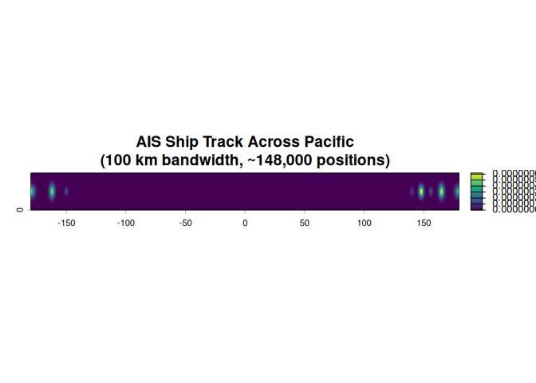
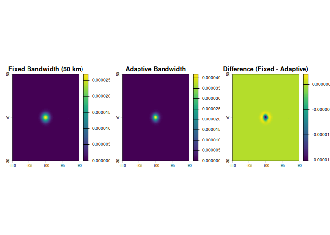
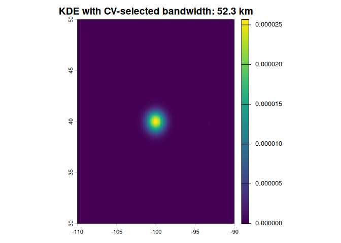

<!-- README.md is generated from README.Rmd. Please edit that file -->

# geodensity

<!-- badges: start -->

[](https://github.com/brownag/geodensity/actions/workflows/R-CMD-check.yml)
[](https://creativecommons.org/publicdomain/zero/1.0/)
[](https://www.rust-lang.org)
<!-- badges: end -->

Fast kernel density estimation on geographic grids using geodesic
(great-circle) distances.

## Overview

Traditional kernel density estimation (KDE) relies on Euclidean planar
distance, which causes severe geometric distortion for geographic
coordinates on a sphere and fails at boundaries like the international
dateline.

The **`geodensity`** package computes kernel density estimates directly
on geographic coordinates (longitude/latitude) using great-circle
geodesic distances via the **Haversine formula**. The computationally
intensive steps are implemented in a high-performance Rust backend using
**Rayon** for multi-core parallelization, scaling effortlessly to
millions of point locations.

### Key Features

- **Geodesic Correctness**: True great-circle distance accounting for
  spherical curvature without requiring planar map reprojection.
- **Antimeridian & Pole Handling**: Automatic wrapping across the
  international dateline (±180° longitude) and proper high-latitude
  geometry.
- **High-Performance Rust Backend**: Multi-threaded parallel evaluation
  with spatial indexing and adaptive bounding boxes via `extendr` and
  `rayon`.
- **Fixed & Adaptive Bandwidth**: Standard fixed-bandwidth KDE as well
  as adaptive-bandwidth methods (`"balloon"` and `"sample_point"`).
- **Automated Bandwidth Selection**: Leave-one-out cross-validation
  (`bandwidth_optimize()`) to objectively select optimal smoothing
  parameters.
- **Spatial Ecosystem Integration**: Seamless interoperability with
  `terra` (`SpatVector`, `SpatRaster`) and `sf` point geometries.

## Installation

You can install the development version of `geodensity` from GitHub:

``` r
# Using pak
pak::pkg_install("brownag/geodensity")

# Or using remotes
remotes::install_github("brownag/geodensity")
```

### System Requirements

Building from source requires:

- **R** (\>= 4.2)
- **Rust** (\>= 1.80) and `cargo`

## Core Functions

| Function                                                   | Description                            | Primary Inputs                                                          |
|:-----------------------------------------------------------|:---------------------------------------|:------------------------------------------------------------------------|
| [`kde_geodesic()`](#example-ship-track-across-the-pacific) | Fixed-bandwidth geodesic KDE           | Points (`x`), Template raster (`r`), `bandwidth` (km)                   |
| [`kde_adaptive()`](#adaptive-bandwidth)                    | Adaptive-bandwidth geodesic KDE        | Points (`x`), Template raster (`r`), `pilot_bandwidth`, `min_bandwidth` |
| [`bandwidth_optimize()`](#bandwidth-selection)             | Leave-one-out cross-validation (LOOCV) | Points (`x`), `bandwidth_min`, `bandwidth_max`, `n_bandwidths`          |

> **Note**: Input points and raster templates must be in a **Geographic
> CRS** (unprojected longitude/latitude, such as `EPSG:4326` or
> `OGC:CRS84`).

------------------------------------------------------------------------

## Example: Ship Track Across the Pacific

To demonstrate geodesic accuracy and dateline wrapping, consider
simulated AIS (ship position) data from a vessel traversing the Pacific
Ocean across the international dateline (±180° longitude).

``` r
library(geodensity)
library(terra)

# Simulate dense AIS positions across the Pacific
# Points cluster at slow/stopped locations and disperse during fast transit
set.seed(123)

fast1 <- data.frame(
  lon = rnorm(3000, mean = 140, sd = 0.5),
  lat = rnorm(3000, mean = 15, sd = 2)
)
slow1 <- data.frame(
  lon = rnorm(30000, mean = 148, sd = 1),
  lat = rnorm(30000, mean = 15, sd = 3)
)
fast2 <- data.frame(
  lon = rnorm(4000, mean = 156, sd = 0.5),
  lat = rnorm(4000, mean = 15, sd = 2)
)
slow2 <- data.frame(
  lon = rnorm(35000, mean = 165, sd = 1.2),
  lat = rnorm(35000, mean = 15, sd = 3.5)
)

# Major cluster centered exactly on the dateline (+/- 180 degrees)
dateline_cluster <- data.frame(
  lon = rnorm(40000, mean = 180, sd = 2),
  lat = rnorm(40000, mean = 15, sd = 3)
)

crossing <- data.frame(
  lon = c(rep(170, 100), rep(173, 100), rep(176, 100), rep(-176, 100), rep(-173, 100), rep(-170, 100)),
  lat = rnorm(600, mean = 15, sd = 1)
)
slow3 <- data.frame(
  lon = rnorm(32000, mean = -162, sd = 1.2),
  lat = rnorm(32000, mean = 15, sd = 3.5)
)
fast3 <- data.frame(
  lon = rnorm(3500, mean = -150, sd = 0.5),
  lat = rnorm(3500, mean = 15, sd = 2)
)

pts <- rbind(fast1, slow1, fast2, slow2, dateline_cluster, crossing, slow3, fast3)
pts_vec <- terra::vect(pts, geom = c("lon", "lat"), crs = "OGC:CRS84")

# Create an output template raster spanning the Pacific basin
template <- terra::rast(
  extent = c(-180, 180, 0, 30),
  resolution = 0.25,
  crs = "OGC:CRS84"
)

# Compute geodesic kernel density estimate
dens <- kde_geodesic(pts_vec, template, bandwidth = 100)
#> Computing geodesic KDE: 148100 points, 172800 grid cells, 100.0 km bandwidth

# Visualize density surface
plot(dens, main = "AIS Ship Track Across Pacific\n(100 km bandwidth, ~148,000 positions)")
```



The resulting density surface illustrates geodesic continuity across the
antimeridian: the point cluster centered at 180° splits seamlessly
between the far right (+180°) and far left (-180°) of the raster extent.
Planar Euclidean KDE would treat the edges as opposing ends of the map,
producing artificial boundary artifacts and severe distortion.

------------------------------------------------------------------------

## Adaptive Bandwidth

For point patterns with heterogeneous density—such as dense urban
clusters surrounded by sparse rural landscapes—fixed bandwidths can
over-smooth dense clusters or under-smooth sparse regions.

`kde_adaptive()` provides two adaptive estimators:

- **`method = "balloon"`** (default): Evaluates pilot density at each
  grid cell and dynamically scales the evaluation bandwidth per cell.
- **`method = "sample_point"`**: Evaluates pilot density at each input
  data point and scales the bandwidth individual to that point.

Bandwidth scaling is parameterized by `scaling`:

- **`"ratio"`** (default):
  `bw = min + (pilot - min) / (1 + sqrt(d / d_max))`
- **`"linear_sqrt"`**:
  `bw = min + (pilot - min) * (1 - sqrt(d / d_max))`

``` r
# Generate sample data with clustered and sparse distributions
set.seed(42)
dense_cluster <- data.frame(
  lon = rnorm(500, mean = -100, sd = 0.5),
  lat = rnorm(500, mean = 40, sd = 0.5)
)
sparse_region <- data.frame(
  lon = runif(100, -110, -90),
  lat = runif(100, 30, 50)
)
pts_adaptive <- rbind(dense_cluster, sparse_region)
pts_adaptive_vec <- terra::vect(pts_adaptive, geom = c("lon", "lat"), crs = "EPSG:4326")

template_adaptive <- terra::rast(
  extent = c(-110, -90, 30, 50),
  resolution = 0.1,
  crs = "EPSG:4326"
)

# Compute fixed vs adaptive KDE
dens_fixed <- kde_geodesic(pts_adaptive_vec, template_adaptive, bandwidth = 50)
#> Computing geodesic KDE: 600 points, 40000 grid cells, 50.0 km bandwidth
dens_adaptive <- kde_adaptive(
  pts_adaptive_vec,
  template_adaptive,
  pilot_bandwidth = 50,
  min_bandwidth = 5
)
#> Computing adaptive geodesic KDE: 600 points, 40000 grid cells, 50.0 km pilot bandwidth, 5.0 km min bandwidth

# Visualize comparison
par(mfrow = c(1, 3))
plot(dens_fixed, main = "Fixed Bandwidth (50 km)")
plot(dens_adaptive, main = "Adaptive Bandwidth")
plot(dens_fixed - dens_adaptive, main = "Difference (Fixed - Adaptive)")
```



### Normalization and Interpretation

- **Probability Density**: Density values are expressed in probability
  density per square kilometre (km⁻²).
- **Balloon Estimator**: Locally normalized per grid cell; suited for
  visual contrast and hotspot discovery.
- **Sample-Point Estimator**: Individual kernels are normalized per
  point and integrate to approximately 1 over the spherical domain.

------------------------------------------------------------------------

## Bandwidth Selection

Selecting an appropriate bandwidth is critical in KDE.
`bandwidth_optimize()` uses **leave-one-out cross-validation (LOOCV)**
to evaluate candidate bandwidths:

``` r
# Evaluate candidate bandwidths via leave-one-out cross-validation
bw_cv <- bandwidth_optimize(
  pts_adaptive_vec,
  bandwidth_min = 5,
  bandwidth_max = 200,
  n_bandwidths = 12,
  verbose = TRUE
)
#> Evaluating 12 bandwidth values via leave-one-out cross-validation...
#> 
#> Bandwidth evaluation results:
#>   Bandwidth 5.0000 km: LL = -7.6625
#>   Bandwidth 6.9922 km: LL = -7.3510
#>   Bandwidth 9.7781 km: LL = -7.1404
#>   Bandwidth 13.6740 km: LL = -6.9122
#>   Bandwidth 19.1222 km: LL = -6.5942
#>   Bandwidth 26.7411 km: LL = -6.2795
#>   Bandwidth 37.3956 km: LL = -5.9592
#>   Bandwidth 52.2953 km: LL = -5.8230 <-- OPTIMAL
#>   Bandwidth 73.1315 km: LL = -5.9075
#>   Bandwidth 102.2696 km: LL = -6.1536
#>   Bandwidth 143.0172 km: LL = -6.5167
#>   Bandwidth 200.0000 km: LL = -6.9347
#> 
#> Optimal bandwidth: 52.2953 km

# Compute density using the optimal bandwidth
dens_optimal <- kde_geodesic(
  pts_adaptive_vec,
  template_adaptive,
  bandwidth = bw_cv$bandwidth_opt
)
#> Computing geodesic KDE: 600 points, 40000 grid cells, 52.3 km bandwidth

plot(
  dens_optimal,
  main = paste("KDE with CV-Selected Bandwidth:", round(bw_cv$bandwidth_opt, 2), "km")
)
```



The bandwidth maximizing average log-likelihood across held-out points
is selected as `bandwidth_opt`.

**Quick Reference (Normal Reference Rule)**: A fast heuristic for
two-dimensional point patterns is `h = sigma_km * n^(-1/6)`, where
`sigma_km` is the root-mean-square standard deviation of point
coordinates in kilometres and `n` is point count. Cross-validation
typically selects tighter bandwidths for clustered point data.

------------------------------------------------------------------------

## Performance & Scalability

The Rust computation engine uses a spatial cell hash index with
latitude-dependent search bounds:

- **Memory Efficient**: Memory consumption scales with the grid cell
  count of the output raster, not the number of input points.
- **Parallel Execution**: Grid cells are evaluated in parallel across
  CPU threads using Rayon.
- **Sublinear Scaling**: Points outside the kernel cutoff (3 \*
  bandwidth) are pruned early using spatial indexing.

------------------------------------------------------------------------

## References

- **Haversine Formula**: Sinnott, R. W. (1984). Virtues of the
  Haversine. *Sky and Telescope*, 68(2), 159.
- **Kernel Density Estimation**: Silverman, B. W. (1986). *Density
  Estimation for Statistics and Data Analysis*. Chapman and Hall,
  London.
- **terra**: Hijmans, R. J. (2024). *terra: Spatial Data Analysis*. R
  package.
